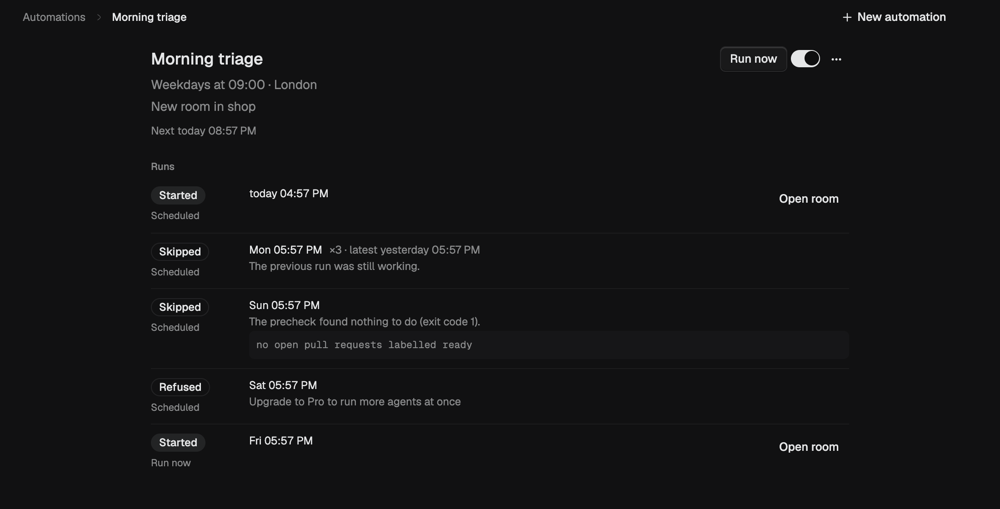

An automation is a saved prompt and when it runs. Each run starts a fresh room in your project, or sends the prompt to a room you already have, with the model and access you choose.

## When it runs

- Every hour, every day, on weekdays or on the days you pick, in your own time zone
- Only when you press **Run now**
- When something changes on GitHub, like a pull request's checks passing: ask an agent in a room to set it up

## Stays in your hands

- Every run is listed: started, skipped or refused, with the reason
- An optional check command skips a run when there is nothing to do
- When a run needs your permission, the automation shows **Waiting for you** and skips later runs until you answer
- Missed a run because your computer was asleep? It runs once when it wakes, within 12 hours
- Automations on other computers you control show up too

Automations are included with Pro.
