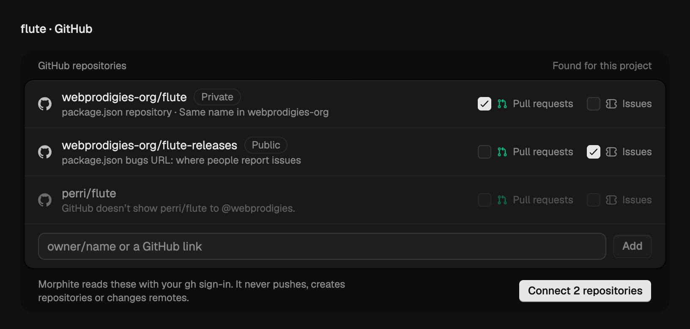
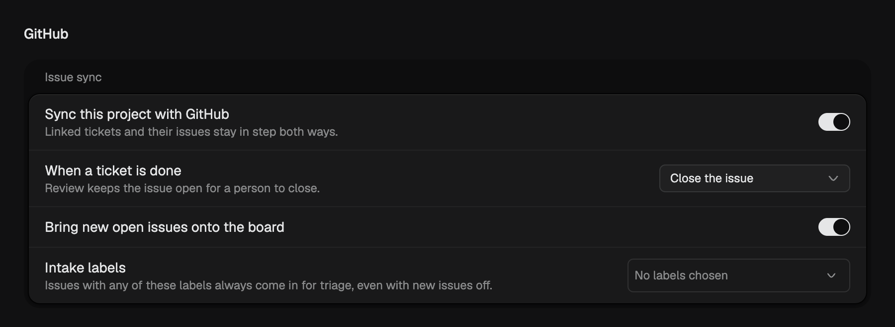

Connect GitHub in **Settings › Connections** with your GitHub CLI sign-in, and every project gets a GitHub area.

## Link your repositories

Morphite looks at your project folder and suggests the repositories that belong to it, from its Git remote, `package.json` and more. Tick the ones you want, choose what each one brings in (pull requests, issues or both), and connect them in one click.

Morphite reads GitHub with your own sign-in. It never pushes, creates repositories or changes your remotes.

## Pull requests at a glance

Open **Pull requests** next to the board to see every open pull request, the room working on its branch and how its checks are doing. Open one to read its checks and comments in the side panel. A room working on a pull request shows it right above the chat box.

## Issues and tickets, in sync

Turn on **Issue sync** for a project and its GitHub issues come onto the board as tickets. Changes travel both ways: update a ticket or its issue and the other follows. When a ticket is done, Morphite closes its issue, or leaves it open for review if you prefer.

- Nothing is imported or written to GitHub until you turn sync on for that project
- Intake labels, like `bug`, bring their issues in even when you keep new issues off
